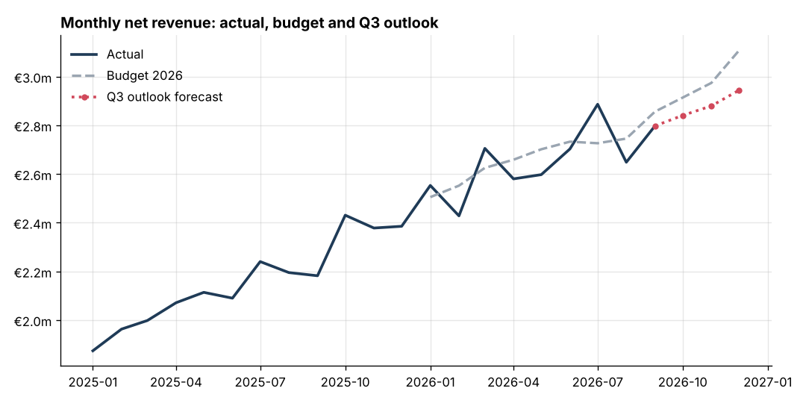
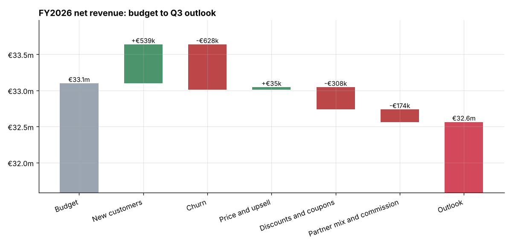
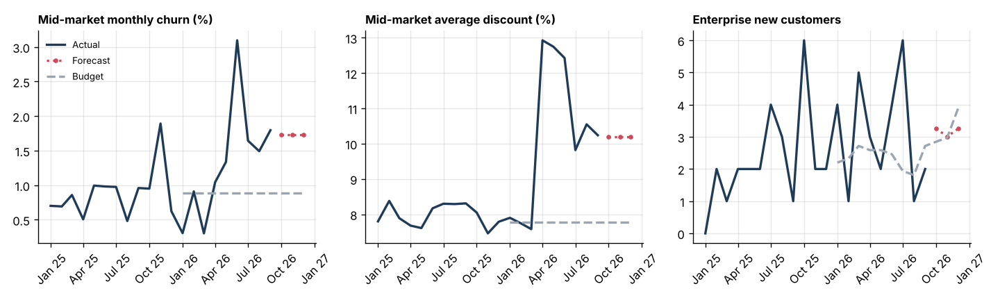

# SaaS Revenue and Margin Forecast: Budget, Outlook and Long-Term Plan

A driver-based revenue and gross margin model for a fictional B2B software company that sells EHS / ESG compliance software (health & safety, environment, sustainability reporting) on subscription. The project builds a 2026 budget, two in-year outlooks, a three-year plan and a quarterly outlook report for the board, all from the same set of business drivers.

> **Data:** all data is synthetic and created in `src/make_data.py`. It does not describe any real company.

## Why I built it

In FP&A the revenue forecast is not one number. It is a budget set before the year starts, outlooks that are updated each quarter as actuals come in, and a long-term plan. Each version has to be explained: why is the outlook below budget, and which business driver caused the gap?

I wanted a model where every revenue line can be traced back to a driver that someone in the business owns (sales, customer success, pricing, partners), and where budget, outlook and plan are calculated in exactly the same way.

## Business questions

| Question | Where in the project |
|---|---|
| What will net revenue and gross margin be this year? | Q3 outlook (9 months actual + 3 months forecast) |
| How far are we from budget, and why? | Budget vs outlook table and revenue bridge |
| How did the outlook change since last quarter? | Budget vs Q2 outlook (6+6) vs Q3 outlook (9+3) |
| What happens if churn or new sales get worse? | Downside / base / upside scenarios |
| What does this mean for the next three years? | Long-term plan 2027-2029 |
| Can we trust the forecast method? | Backtest against two simple benchmarks |

### Drivers

| Driver | What it means for the company |
|---|---|
| New customers | New subscriptions won per month, by segment |
| Churn rate | Share of customers who cancel each month |
| Price increase, expansion | January list price increase, and monthly upsell (more modules or users) |
| Discount rate | Average discount and coupons on the list fee |
| Partner share, commission rate | Share of revenue sold through reseller partners, and the commission paid to them |
| Onboarding fee | One-off implementation fee per new customer (services revenue) |
| Unit costs | Hosting and support cost per customer, services delivery cost, third-party licences |

There are two segments, Mid-market and Enterprise, so the model also shows the effect of the business mix (subscription vs services, mid-market vs enterprise, direct vs partner).

## How the model works

```
closing customers   = opening customers + new customers - churned customers
fee per customer    = last month's fee x (1 + price increase) x (1 + expansion)
gross subscription  = closing customers x fee per customer
net subscription    = gross subscription - discounts - partner commission
services revenue    = new customers x onboarding fee
net revenue         = net subscription + services revenue
gross profit        = net revenue - hosting - support - services delivery - licences
```

This is in `src/revenue_model.py`. The same function (`build_pnl`) is used for actuals, budget, outlook, scenarios and plan, so any difference between versions comes from the drivers only.

**Budget 2026** (`src/plan.py`) is built as in December 2025: 2025 new customers plus a growth target, spread over the months with the usual seasonality; churn and expansion at the 2025 average; discount and partner share at the Q4 2025 level; and a planned January price increase.

**Outlook** (`src/forecast.py`) = actual months + forecast for the rest of the year.
- New customers have trend and seasonality, so they are forecast with Holt-Winters exponential smoothing (statsmodels), per segment.
- The other drivers change slowly, so they use recent averages (e.g. churn = average of the last 6 months, discount = last 3 months).

**Bridge** (`src/variance.py`): start from the budget drivers and replace one group at a time with the outlook drivers (new customers, churn, price, discount, partner commission, unit costs). The change at each step is the effect of that driver. The steps add up exactly to the total difference (this is checked in the tests).

**Long-term plan**: each plan year starts from the year before, using the growth and price assumptions in `src/config.py`.

## Results: Q3 2026 outlook

The full board report is in [`reports/board_outlook_2026_Q3.md`](reports/board_outlook_2026_Q3.md). In short:

- Net revenue outlook is €32.6m, €536k (1.6%) below budget and 26% above 2025.
- The gap comes from mid-market: higher churn since April (-€628k), a coupon campaign in Q2 that pushed discounts up (-€308k) and more sales through partners, which means more commission (-€174k).
- Enterprise is ahead of budget with 28 new customers to September against 21 planned. Together, new customers add +€539k against budget.
- December ARR is expected at €32.5m, €1.4m below budget. This matters more than the in-year gap, because it is the starting point for 2027. In the downside scenario 2027 net revenue is €34.9m, against €39.8m in the base case.







### Forecast accuracy

I tested the method on three past dates (September 2024, March 2025, September 2025), each time forecasting the next 12 months and comparing with what happened. Two simple benchmarks: same month last year scaled by recent growth (seasonal naive), and Holt-Winters on total revenue without drivers.

The driver-based forecast had the lowest monthly error in two of the three tests, but it is not better every time. Subscription revenue is stable, so simple methods are also close on the total. The main reason to use drivers is that the forecast can be explained and discussed with the business, and the same drivers carry into budget and plan. Results are in `outputs/backtest_scores.csv` and in the board report.

## How to run

```bash
python -m venv .venv
source .venv/bin/activate        # Windows: .venv\Scripts\activate
pip install -r requirements.txt

python src/main.py               # creates data, tables, charts and the board report
pytest                           # runs the tests
```

All assumptions are in `src/config.py`. Change for example the 2026 events or the plan growth rates and run `main.py` again; all tables, charts and the report are recalculated.

## Project structure

```text
src/
  config.py          all assumptions (no numbers hardcoded elsewhere)
  make_data.py       synthetic monthly actuals, Jan 2022 to Sep 2026
  revenue_model.py   drivers -> customers, revenue lines, costs, gross margin
  forecast.py        driver forecast, outlook, scenarios, backtest
  plan.py            budget and long-term plan
  variance.py        version comparison and revenue bridge
  report.py          charts and the board report
  main.py            runs everything
data/                synthetic driver data
outputs/             CSV tables and charts
reports/             quarterly board outlook (Markdown)
tests/               checks that customers, revenue and the bridge add up
```

## Limitations

- Onboarding fees are recognised in the month the customer is won. In practice they are spread over the implementation period.
- Subscription revenue is calculated on the month-end customer base. It ignores customers who join or leave mid-month.
- New customers are forecast with a time series model. With real data I would use the sales pipeline (deal stage, expected close date, win rate) for the next one or two quarters.
- Churn is a single rate per segment. A cohort view (churn by customer age, contract size and renewal date) would give a better forecast.
- There are no operating expenses below gross profit, so the model stops at gross margin.
