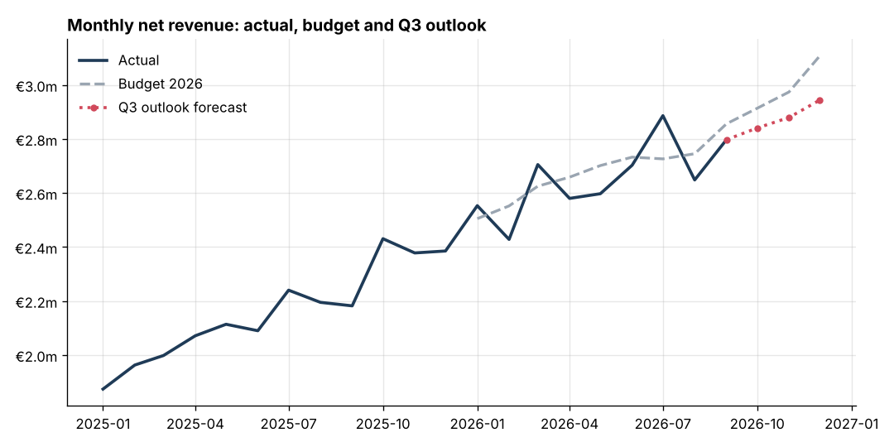
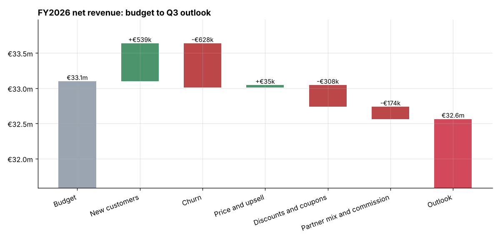
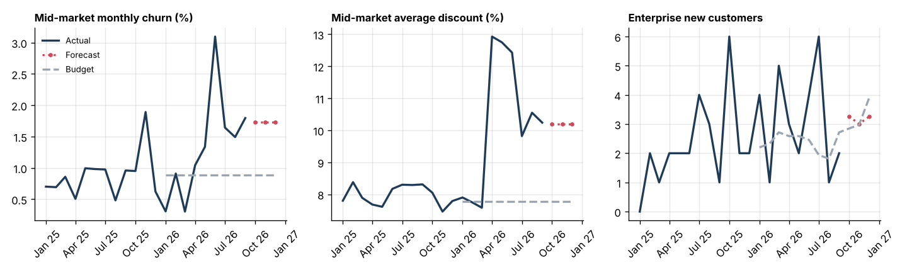
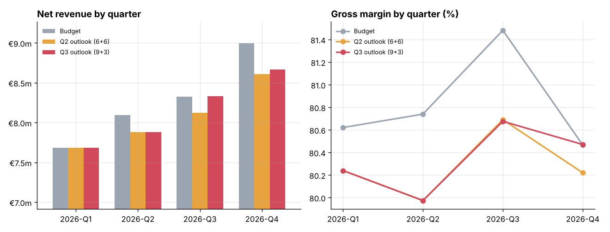
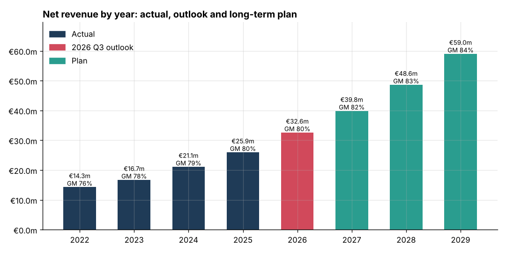
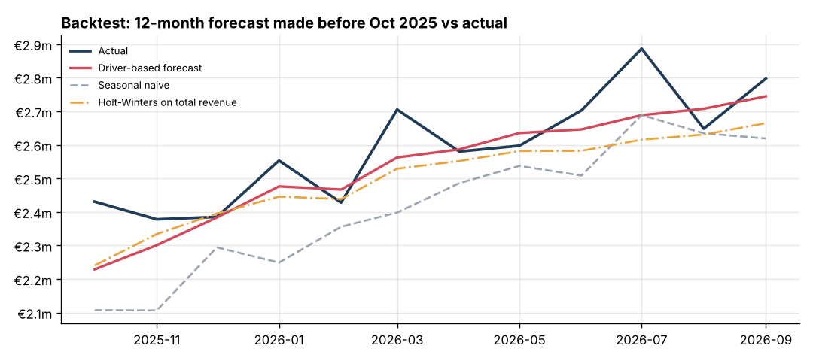

# Quarterly outlook 2026: Q3 (9+3)

*Fictional EHS / ESG software company. Synthetic data. Actuals to September 2026, forecast October to December.*

## Summary

- The Q3 outlook for net revenue is **€32.6m**, €536k (1.6%) below budget and 25.6% above 2025.
- Compared with the Q2 outlook, the full-year number changed by +€263k. The Q2 outlook was made while the coupon campaign was running and assumed the higher discount would continue; in Q3 the discount came down and enterprise wins were strong.
- Gross margin is 80.3%, -0.5 pp against budget.
- The largest negative item in the bridge is **churn** (-€628k); the largest positive item is **new customers** (+€539k).
- December ARR is expected at €32.5m against €33.9m in the budget. This is the starting point for the 2027 budget.

## Full year 2026: budget vs outlook

|  | Budget 2026 | Q2 outlook | Q3 outlook | Q3 outlook vs budget |
|---|---|---|---|---|
| Net revenue | €33.1m | €32.3m | €32.6m | -€536k (-1.6%) |
|   of which subscription | €30.9m | €30.0m | €30.2m | -€703k (-2.3%) |
|   of which services | €2.2m | €2.3m | €2.4m | +€167k (+7.5%) |
| Gross profit | €26.8m | €25.9m | €26.2m | -€588k (-2.2%) |
| Gross margin | 80.8% | 80.3% | 80.3% | -0.5 pp |
| Customers (Dec) | 894 | 849 | 838 | -57 |
| ARR (Dec) | €33.9m | €32.4m | €32.5m | -€1,410k (-4.2%) |

## What explains the difference

| Step | Net revenue | Gross profit |
|---|---|---|
| Budget | €33.1m | €26.8m |
| New customers | +€539k | +€386k |
| Churn | -€628k | -€530k |
| Price and upsell | +€35k | +€34k |
| Discounts and coupons | -€308k | -€308k |
| Partner mix and commission | -€174k | -€174k |
| Onboarding fees | +€0k | +€0k |
| Unit costs | +€0k | +€4k |
| Outlook | €32.6m | €26.2m |

- **Churn.** Mid-market churn averaged 1.74% per month from April to September, against 0.89% in the budget. Each month we lose more customers than planned, and the effect grows every month because lost customers do not come back in the forecast.
- **Discounts.** The Q2 coupon campaign raised the average mid-market discount to 12.7% (budget 7.8%). In Q3 it came down to 10.2% but did not go back to the budget level.
- **Partner commission.** The share of mid-market revenue sold through partners is 35.9% so far this year (budget 29.2%), so we pay more commission.
- **New customers.** Enterprise won 28 new customers to September against 21 in the budget. This brings both subscription and onboarding revenue and offsets part of the mid-market gap.

| Segment | Budget net revenue | Outlook net revenue | Variance | Gross profit variance |
|---|---|---|---|---|
| Enterprise | €18.4m | €18.9m | +€547k | +€348k |
| Mid-market | €14.7m | €13.7m | -€1,083k | -€937k |

## By quarter

Q4 net revenue: budget €9.0m, Q3 outlook €8.7m (-€331k).

## Scenarios

Only Q4 is still open in 2026, so the range for this year is narrow. The effect on next year is larger, because the December customer base and the same driver changes carry into 2027.

| Scenario | Net revenue 2026 | ARR Dec 2026 | Net revenue 2027 | Gross margin 2027 |
|---|---|---|---|---|
| Downside | €32.1m | €31.1m | €34.9m | 81.3% |
| Base | €32.6m | €32.5m | €39.8m | 81.5% |
| Upside | €32.8m | €33.2m | €42.7m | 81.3% |

Scenario rules (applied to forecast months only): Downside: new customers x0.8, churn x1.3, discount x1.15; Upside: new customers x1.15, churn x0.85, discount x0.95.

## Risks and opportunities

- Risk: mid-market churn stays at the current level or rises further. Worth a churn analysis by customer cohort and by reason for cancellation, together with Customer Success.
- Risk: discounts stay above budget if sales keeps using coupons to close deals.
- Opportunity: enterprise wins are ahead of budget. If Q4 wins are in line with Q3, services revenue and ARR end above the outlook.
- Opportunity: the January price increase for 2027 is not yet decided. Each 1% on the list price adds roughly €0.3m to ARR.

## Long-term plan

| Year | Net revenue | Growth | Gross margin | Customers (Dec) | ARR (Dec) |
|---|---|---|---|---|---|
| 2026 (Q3 outlook) | €32.6m | 25.6% | 80.3% | 838 | €32.5m |
| 2027 | €39.8m | 22.3% | 81.5% | 912 | €40.5m |
| 2028 | €48.6m | 22.0% | 82.5% | 995 | €49.6m |
| 2029 | €59.0m | 21.4% | 83.5% | 1,085 | €60.4m |

## How reliable is the forecast?

The same forecast method was tested on three past periods (forecast made in September 2024, March 2025 and September 2025, each for the next 12 months) and compared with two simple benchmarks.

| Method | Average monthly error (MAPE) | Average error on 12-month total |
|---|---|---|
| Driver-based (this model) | 4.6% | 4.0% |
| Seasonal naive | 5.6% | 4.7% |
| Holt-Winters on total revenue | 6.6% | 5.7% |

Subscription revenue is stable, so even simple methods are close on the total. The value of the driver-based forecast is that every change can be explained by a business driver (customers, churn, price, discount, commission), and the same drivers can be used for budget, outlook and plan.
